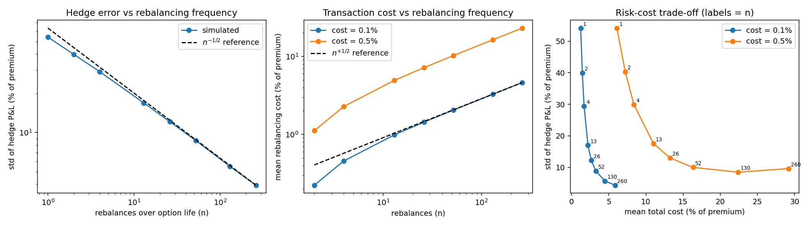

# Option Pricing Lab

Python library and experiments for pricing, validating and delta-hedging equity options,
plus a PyTorch surrogate of the call-price surface. Every number below is produced by a
script in `scripts/` with fixed seeds; outputs are in `results/`.

## Layout

```
optionlab/
  black_scholes.py   closed-form prices and Greeks (calls and puts, dividend yield)
  binomial.py        Cox-Ross-Rubinstein trees, European and American, tree Greeks
  monte_carlo.py     GBM Monte Carlo, antithetic + control variates, confidence intervals
  greeks.py          bump-and-revalue (finite-difference) Greeks for any pricer
  hedging.py         discrete delta-hedging simulator with proportional transaction costs
  validation.py      checks that return measured numbers
  surrogate.py       PyTorch MLP that learns the call-price surface
scripts/             run_validation.py, run_hedging.py, train_surrogate.py
tests/               28 pytest tests
results/             report, figures and CSV/JSON from the runs summarised below
```

## Run

```
pip install -r requirements.txt
pytest -q                          # 28 tests, about 20 s
python scripts/run_validation.py   # results/validation_report.md, validation.png
python scripts/run_hedging.py      # results/hedging_results.csv, hedging_summary.json, hedging.png
python scripts/train_surrogate.py  # about 1 min on one CPU core; results/surrogate_*.{json,pt,png}
```

Seeds are fixed. The PyTorch run can differ slightly across hardware and torch versions.

## Results

### Pricing validation (base case S=K=100, T=1, r=5%, sigma=20%)

| Check | Result |
|---|---|
| Black-Scholes vs numerical integration of the risk-neutral expectation (60 random parameter sets, calls and puts, with dividends) | max gap 1.4e-13 |
| Textbook prices (S=42, K=40, T=0.5, r=10%, sigma=20%) | 4.76 call / 0.81 put reproduced |
| Put-call parity | closed form 1.4e-14, tree 2.8e-12 |
| Tree convergence | log-log slope -1.00 (first order); error 7.8e-4 at 2,560 steps, 4.8e-5 when averaging N and N+1 |
| Textbook two-step American put (Hull) | 5.0896 vs 5.0894 in the book (the book rounds p) |
| American call without dividends vs European | identical |
| Early-exercise premium, ATM American put | 0.517 |
| Monte Carlo 95% CI coverage (500 replications x 20,000 paths) | 94.0-96.4% across four variants |
| Monte Carlo variance reduction vs plain | antithetic 1.9x, control variate 6.6x, both 31x |
| Greeks vs closed form | finite difference <= 2.5e-4, 4,000-step tree <= 2.1e-4, Monte Carlo with common random numbers <= 9.3e-4 (scaled/relative error) |

### Delta hedging (short 1-year ATM call, 50,000 GBM paths, 260 time steps; all figures % of premium)

| Rebalances | P&L std, no costs | P&L std, 0.5% cost | Mean total cost, 0.5% cost |
|---|---|---|---|
| 1 | 54.1 | 54.2 | 6.1 |
| 13 | 16.9 | 17.6 | 11.0 |
| 52 | 8.7 | 10.0 | 16.3 |
| 130 | 5.5 | 8.5 | 22.4 |
| 260 | 3.9 | 9.6 | 29.2 |

Hedge-error std scales as n^-0.48 and rebalancing cost as n^+0.55 (theory: -0.5 and +0.5).
At 0.5% costs, hedging 260 times is worse than 130 on both cost and risk. Hedging with
volatility 5 points too low / too high moves mean P&L by -21.7% / +15.3% of premium.

### PyTorch surrogate (`results/surrogate_metrics.json`)

MLP 4 -> 128 -> 128 -> 128 -> 1 (SiLU, 33,793 parameters) predicting C/K from moneyness,
maturity, rate and volatility. 200,000 training / 20,000 validation / 50,000 test samples,
60 epochs, Adam with one-cycle schedule, MSE loss.

| | RMSE of C/K | in $ per $100 strike |
|---|---|---|
| Network | 0.00138 | 0.14 |
| Cubic polynomial regression | 0.00386 | 0.39 |
| Discounted intrinsic value | 0.0987 | 9.87 |

Autograd delta: RMSE 0.021 vs analytic (max 0.26); vega RMSE 0.020 (mean |vega| 0.30).



## Scope and limits

- Constant-volatility GBM throughout: no stochastic volatility or jumps.
- American pricing is validated by tree convergence, a textbook example and exact bounds,
  not by an independent PDE or least-squares Monte Carlo solver.
- Hedging simulation has no dividends and uses proportional costs only.
- The surrogate only covers S/K 0.7-1.3, T 0.05-2y, r 0-8%, sigma 10-60%. About 2.3% of test
  predictions are slightly negative prices and 1.5% have negative delta (deep out-of-the-money,
  short-dated), and RMSE in the short-dated near-the-money region is 0.0039. It is an
  approximation experiment, not a replacement pricer.
- Not included: LLM fine-tuning and an NLP pipeline.

## Findings and interpretation

- Why is the CRR error first order, and why does averaging N and N+1 steps help? (odd/even oscillation)
- Why does hedge error fall like 1/sqrt(n) while rebalancing cost rises like sqrt(n)?
- Why is daily hedging worse than every-other-day at 0.5% costs?
- Why does a control variate on the terminal stock price work, and what must be known for it? (its mean)
- Why is finite-difference gamma U-shaped in the bump size? (round-off vs truncation)
- Why model C/K instead of C? (homogeneity of degree one removes an input)
- How is delta obtained from the network? (autograd with respect to moneyness)
- What would you add next? (independent American benchmark, stochastic volatility, Leland-adjusted hedging)
